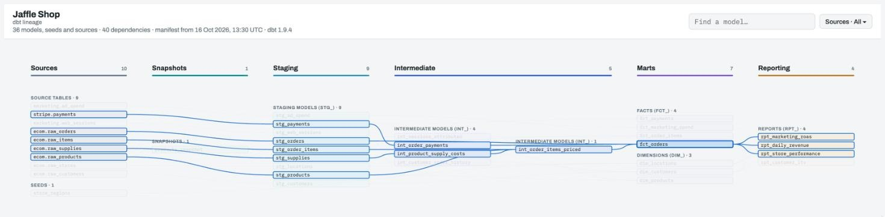
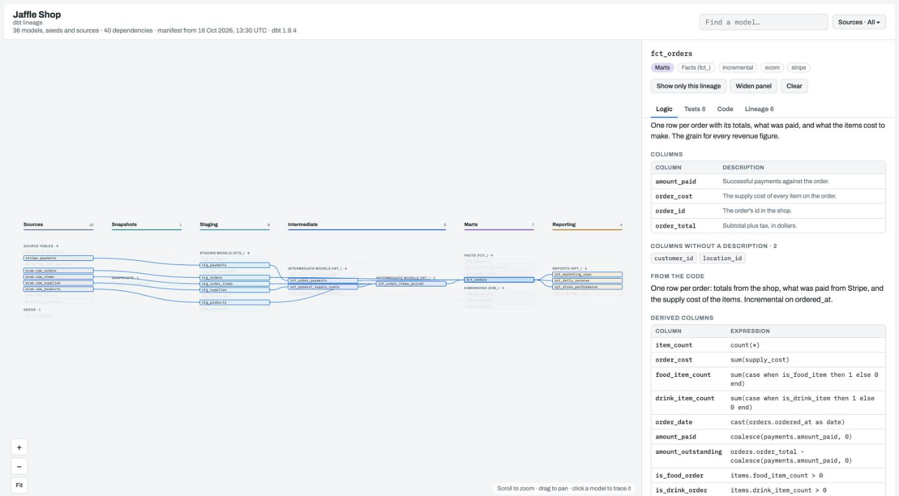

# dbt-lineage

A single, self-contained HTML lineage page for any dbt project, drawn from
`target/manifest.json`. Ships as a [Claude Code](https://claude.com/claude-code) skill
that publishes the page as a Claude artifact at one stable URL, and as a plain Python
script you can run anywhere.



*The [example Jaffle Shop project](examples/jaffle_shop) has three source systems, a seed, a
snapshot, 25 models, 40 dependencies and 45 tests. Here `fct_orders` is selected: everything
it reads from and everything that reads from it is highlighted.*

## Try it

```bash
git clone https://github.com/Calon-Analytics/dbt-lineage.git && cd dbt-lineage
python3 render_lineage.py render --project examples/jaffle_shop --out jaffle-lineage.html
open jaffle-lineage.html        # or xdg-open on Linux
```

You don't need dbt for this: the example's `target/manifest.json` is committed.

## What the page shows

- **Every model, seed, snapshot and source**, in columns from left to right:
  Sources → Snapshots → Staging → Intermediate → Marts → Reporting → Other.
- **Every dependency** (`ref()` and `source()`) as a line. Click a model to highlight
  everything upstream and downstream of it, and **Show only this lineage** to lay out
  just that chain.
- **What each model does** (the *Logic* tab): its dbt description and column
  descriptions first, then what can be read from the SQL — the leading comment block,
  derived columns (`expr AS alias`), `WHERE`/`QUALIFY`/`HAVING` filters and the CTE steps
  in order. Columns without a description are listed, so gaps in your docs are visible.
- **The tests that guard it**, with severity: generic tests (`unique`, `not_null`,
  `relationships → model.field`, `accepted_values`, dbt-utils expressions) and singular
  tests (described by their leading comment).
- **The code**, and a search box.
- **A filter by source system**: each model belongs to every dbt source upstream of
  it. You can group sources into partitions (regions, brands, business units).



The page is one file with its data embedded. It needs no server and no dbt docs site, and
works offline apart from the web fonts. The same manifest always gives the same bytes.

## Requirements

- **Python 3.8 or later, and nothing to install.** The script uses only modules that come
  with Python (`json`, `argparse`, `re`, `pathlib` and so on), so there's no
  `pip install` step.
- **A `lineage.yml` is optional.** Without one, the page uses the defaults described
  below. Add one only to change the title, group sources or set your own column rules.
  Reading it needs [PyYAML](https://pypi.org/project/PyYAML/), which every dbt install
  already includes.
- A dbt manifest. `dbt parse`, `dbt compile`, `dbt run` and `dbt build` all write
  `target/manifest.json`. Tested with manifest schema v12 (dbt 1.8 and later). The
  script reads only long-standing manifest fields, so older 1.x manifests should work.

## Use it as a Claude Code skill

Install it for every project by linking the repo into your skills folder:

```bash
git clone https://github.com/Calon-Analytics/dbt-lineage.git ~/src/dbt-lineage
ln -s ~/src/dbt-lineage ~/.claude/skills/dbt-lineage
```

Then, in Claude Code, from inside a dbt project:

```
/dbt-lineage                 # the dbt project at or above the working directory
/dbt-lineage path/to/project
```

Or just ask: *"draw the lineage for this dbt project"*.

Claude renders the page, publishes it as a **private** artifact and records the URL in
`<project>/.dbt-lineage.json`. Next time it updates the same artifact, so the link you
shared keeps working. If the manifest hasn't changed, it does nothing. Commit
`.dbt-lineage.json` if teammates should republish to the same link, or gitignore it.

The skill never runs dbt against your warehouse. If there is no manifest, it offers to
run `dbt parse`, which needs a working profile but builds nothing.

## Use it without Claude

```bash
python3 render_lineage.py render --project path/to/dbt_project --out lineage.html
open lineage.html
```

| Option | Default |
|---|---|
| `--project DIR` | required; must contain `dbt_project.yml` |
| `--out FILE` | required; the HTML page to write |
| `--manifest PATH` | `DIR/target/manifest.json` |
| `--config PATH` | `DIR/lineage.yml` (or `lineage.yaml`) if present |

It prints one JSON line describing the result, which is easy to use in CI:

```json
{"status": "rendered", "out": "lineage.html", "sha256": "…", "byte_size": 43907,
 "size_tier": 1, "node_count": 10, "edge_count": 9,
 "manifest_generated_at": "2026-10-16T12:00:00Z", "title": "Jaffle Shop",
 "stale": null, "warnings": [], "config": "lineage.yml",
 "artifact_url": null, "unchanged": false}
```

| Exit code | `status` | Meaning |
|---|---|---|
| 0 | `rendered` | The page was written. |
| 2 | `usage` | The folder has no `dbt_project.yml`. |
| 3 | `no_manifest` | No manifest yet: run `dbt parse`. |
| 4 | `too_large` | Over 15 MB even with all code left out. |
| 5 | `invalid` | The manifest or `lineage.yml` can't be read; `detail` says why. |

`stale` is set when a file under `models/`, `seeds/`, `snapshots/` or `macros/` changed
after the manifest was written, so the page may be behind your code.

To publish somewhere else (S3, GitHub Pages, an internal wiki), upload the file. To get
the "unchanged" check without Claude, record what you published:

```bash
python3 render_lineage.py record --project DIR --url https://… --sha256 <sha256>
```

## How models are placed in columns

Sources and seeds go in **Sources**; snapshots in **Snapshots**. Every model is checked
against a list of rules, in three passes:

1. **dbt tags.** Do any of the model's tags (`tags:` in its config or in
   `dbt_project.yml`) match a rule's tags?
2. **Name prefix.** Does the model's name start with one of a rule's prefixes?
3. **Folder.** Is any directory on the model's path under `models/` one of a rule's
   folders?

A tag is a deliberate choice, so it beats the name and the folder. Within a pass, the
first rule that matches wins. Matching ignores case. A model nothing matches goes in
**Other**.

Once the column is chosen, the model's *kind* (the group it sits in within the column,
such as "Facts" or "Dimensions") comes from the most specific rule for that column:
prefix first, then tag, then folder. So a folder-wide tag like `+tags: ["marts"]` puts
everything in `models/marts/` in Marts, and the `fct_` and `dim_` prefixes still split
it into facts and dimensions. The example project does exactly this.

The default rules follow dbt Labs'
[project structure guide](https://docs.getdbt.com/best-practices/how-we-structure/1-guide-overview):

| Column | Tags | Name prefixes | Folders |
|---|---|---|---|
| Staging | `base`, `staging`, `stg` | `base_`, `stg_` | `base`, `staging`, `stage`, `stg` |
| Intermediate | `intermediate`, `int` | `int_` | `intermediate`, `int` |
| Marts | `fact`, `facts`, `fct`, `dimension`, `dimensions`, `dim`, `marts`, `mart` | `fct_`, `fact_`, `dim_`, `mart_` | `marts`, `mart`, `core` |
| Reporting | `reporting`, `report`, `reports` | `rpt_`, `report_` | `reporting`, `reports`, `report` |
| Other | anything else | | |

If your project marks its layers another way, set your own columns and rules in
`lineage.yml`. For example, a project that tags every model with its medallion layer
needs only tags:

```yaml
layers:
  - {id: bronze, label: Bronze}
  - {id: silver, label: Silver}
  - {id: gold, label: Gold}
rules:
  - {kind: bronze, label: Bronze tables, layer: bronze, tags: [bronze]}
  - {kind: silver, label: Silver tables, layer: silver, tags: [silver]}
  - {kind: gold, label: Gold tables, layer: gold, tags: [gold]}
```

## Configuration: `lineage.yml`

Optional, in the project root next to `dbt_project.yml`. Every key is optional. An
unknown key is an error, so a typo can't fail silently. See
[`examples/lineage.yml`](examples/lineage.yml) for a commented example.

| Key | What it does |
|---|---|
| `title` | The page title. Default: the manifest's `project_name`. |
| `partitions` | A list of `{label, sources}`. The filter then lists these groups instead of single sources; unlisted sources go in "Other sources". A listed source the manifest doesn't have shows up as a warning. |
| `partition_name` | The filter's name when partitions are set, e.g. `Region`. |
| `layers` | The columns, in order, as `{id, label}`. `source` and `other` are always added. |
| `rules` | Replaces the default rules. Each is `{kind, label, layer, tags, prefixes, folders}`: `kind` and `layer` are required, `layer` must be one of the `layers`, and `tags`, `prefixes` and `folders` take a list or a single string. A rule can use any of the three; see [How models are placed in columns](#how-models-are-placed-in-columns). |
| `shared_kinds` | Kinds (e.g. `dim`) that don't pass their source systems downstream, so a mart that joins a conformed dimension isn't tagged with every source that feeds the dimension. |

## Large projects

Artifacts have a 16 MB limit, so the page is capped at 15 MB in three steps: first all
code is included; then staging and snapshot code is left out; then all code is left out.
The Logic summaries stay at every step. A project of about 560 models renders to about
5 MB with all its code.

## Files

| File | What it is |
|---|---|
| `SKILL.md` | The Claude Code skill: steps for rendering, publishing and recording. |
| `render_lineage.py` | The renderer and the `record` command. |
| `template.html` | The page: layout, drawing, panel and filter. The renderer fills in `__TITLE__` and `__DATA__`. |
| `examples/jaffle_shop/` | A complete example dbt project, with its manifest committed. |
| `examples/lineage.yml` | A commented example configuration that uses every key. |
| `tests/` | Unit tests and a minimal fixture project. |

## Development

```bash
python3 -m unittest discover tests
```

The tests use the minimal fixture in `tests/fixtures/jaffle_shop`.

The example project is a real dbt project: its SQL, YAML and tests are all in
`examples/jaffle_shop/`. After changing it, regenerate the manifest with any dbt 1.x and
the DuckDB adapter. `dbt parse` doesn't connect to the database:

```bash
pip install dbt-core dbt-duckdb
cd examples/jaffle_shop && dbt parse --profiles-dir .
```

Before committing the new manifest, remove anything personal from it: the absolute paths
in `root_path` and the `metadata` keys `user_id`, `invocation_id` and `env`.

Model data is embedded as JSON in a `<script type="application/json">` block, with
`<`, `>` and `&` escaped, so SQL containing `</script>` can't break the page. Each loop is
capped (50,000 nodes at most), and a dependency cycle is reported as invalid instead of
looping forever.

## Not covered

- Column-level lineage.
- Exposures, metrics and semantic models. They aren't drawn as nodes.
- Running dbt. The page shows whatever the last manifest describes.

## Origin

Carved out of the lineage page in [Calon Analytics](https://calonanalytics.com)' Backbone
platform, without its Data Vault specifics.

## Licence

[Apache License 2.0](LICENSE), the same licence as dbt Core.
